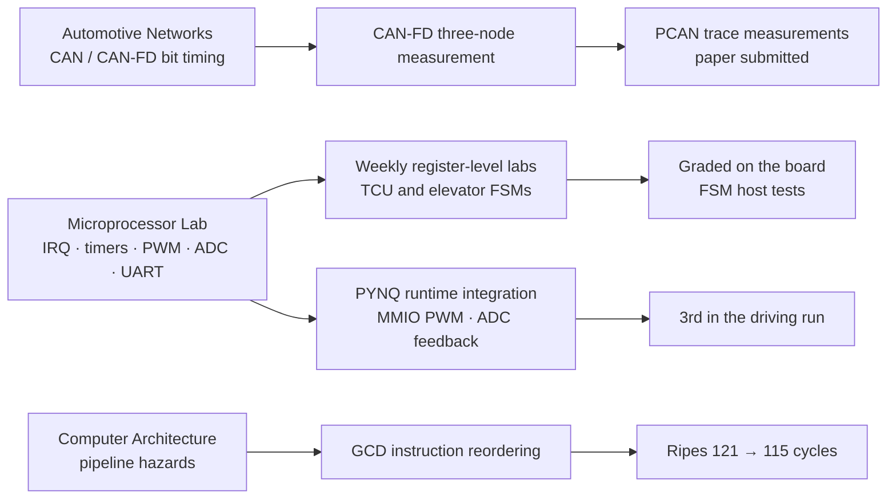

# Yong Hoon Choi | 최용훈

Electronic and Electrical Engineering, Sungkyunkwan University · [한국어](README.md)

I work on memory-system validation and embedded software. My earlier projects involved MCU control, CAN-FD measurements and autonomous vehicles. Since August 2026, I have been undertaking an industry practicum with Samsung Electronics DS, DRAM Solution Team.

I am interested in **memory-error observability and reliability testing**: distinguishing software-requested operations, hardware activity, and what an error record can actually establish.

## Focus areas

- **Memory-system validation** — server DDR5 RDIMM platform testing and Linux machine-check error observation (practicum)
- **Embedded firmware** — interrupts, timers, PWM, ADC and UART configured at register level on a Renesas RA6M3, state machines with host tests
- **In-vehicle networks and measurement** — jitter measured from PCAN traces on a three-node CAN-FD testbed, with a confound check
- **Computer architecture** — hazards and instruction scheduling on a five-stage RISC-V pipeline

## Samsung Electronics DS | DRAM Solution practicum

My work involves server DDR5 RDIMM validation across physical platform configurations.

- **Platform testing:** Worked with server board, CPU and DIMM population configurations, checking slot/channel mappings and boot/training conditions when interpreting test results.
- **C/Linux implementation:** Built a prototype that connects Linux machine-check notifications to an existing controller error decoder. Investigated event-triggered versus polling observations and debugged reader and record-interpretation issues. The prototype remains under validation; it is not a released tool.
- **Register and controller analysis:** Studied CPU/controller reference material and existing source to understand record-validity fields, error details, CPU-family-dependent decoding and logical DIMM localization. Also studied DDR5 BIOS/MRC CA and DQ/DQS training and timing/voltage margins.

Company source, logs, raw register data and platform identifiers are not published. This section describes only general, externally shareable aspects of the work.

## Research and projects

| Project | Work and result |
|---|---|
| **[CAN-FD signal packing and receive timing](https://github.com/choiYhunn/canfd-signal-packing-timing-evaluation)** · undergraduate research | Analyzed 5 ms control-frame arrival jitter on a three-node Renesas RA6M5/PCAN testbed. I worked on Python trace parsing, QC and statistics, and identified background-traffic cadence as a confound in an early packing-strategy comparison. With the strategy fixed, changing the gap from 238 to 240 μs changed jitter from 26.37 to 56.84 μs (n=3). [Final experiments and verification](https://github.com/choiYhunn/canfd-signal-packing-timing-evaluation/tree/main/final_campaign) |
| **[RA6M3 Microprocessor Lab](https://github.com/choiYhunn/ra6m3-microprocessor-lab)** | Implemented elevator FSM and transmission-control logic using C/FSP. Extracted the personally written control logic into portable C11 modules with host assertion tests; board timing is outside those tests. The weekly assignments (interrupts, timers, PWM, ADC, UART) are published as [diffs against the course skeleton](https://github.com/choiYhunn/ra6m3-microprocessor-lab/tree/main/weekly_labs). |
| **[RISC-V Pipeline Hazard](https://github.com/choiYhunn/riscv-pipeline-hazard-study)** | Reordered GCD instructions on a five-stage Ripes processor *without forwarding*, reducing **121 to 115 cycles** with 61 instructions unchanged. Original submission screenshots are included. |
| **[AI-Chip autonomous vehicle](https://github.com/choiYhunn/skku-ai-chip-autonomous-driving-2026)** | Integrated the PYNQ/Zynq camera–DPU–MMIO motor-control path and performed calibration and repeated vehicle tests. Bronze Award, AI-Chip Division (team). |
| **[AMET orange-line detector experiment](https://github.com/choiYhunn/amet-2026-orange-lane-detector)** | Labeled track images, trained YOLO26n, deployed an ONNX candidate and measured inference latency on the vehicle CPU. p50 was **318.5–376.4 ms** across runs; this candidate was not used in the final race. The team received a Hyundai Mobis Excellence Award with a separate driving stack. |
| **[2025 SKKU autonomous-driving hackathon](https://github.com/choiYhunn/skku-autonomous-driving-hackathon-2025)** | Integrated parking FSM, Pure Pursuit and curvature-based speed control in ROS Noetic. 2nd place (team). |

Other work: [2026 Kookmin University Autonomous Driving Competition, preliminary round](https://github.com/choiYhunn/kookmin-autonomous-driving-competition-2026) and [Shared Brain Starter](https://github.com/choiYhunn/shared-brain-starter).

## Training and coursework

How course and workshop learning turned into implementation and verification. Training I only attended is not presented as implementation.

| Training | Status | My surviving artifacts |
|---|---|---|
| Zonal E/E Architecture workshop (HPC, four zones, CAN↔Ethernet, FreeRTOS) | Attended, Jul 2026 | Run procedure and a one-line debug change; architecture [documented from the original source](TRAINING.en.md#zonal-ee-architecture-workshop) |
| Automotive Ethernet · AUTOSAR (EB tresos) · Automotive Embedded Systems · ROS 2 short courses | Attended | None (only distributed material remains) |
| H-Mobility Class: autonomous-driving communication and networks / Car Inside Out | Basic track completed | Written assignments |
| Automotive Networks · Smart Car Engineering | Coursework | Ringing/SIC analysis report; paper on AI perception and real-time control (literature analysis) |

Per-course detail and what is not published: [Training and coursework](TRAINING.en.md).

## Paper, awards and training

- CAN-FD receive-jitter study: **eight-page full paper submitted** to the 2026 KSAE Autumn Conference (second author; not presented as accepted)
- 2026 AMET Autonomous Driving Hackathon — Hyundai Mobis Excellence Award, 3rd in finals (team)
- 4th SKKU AI Autonomous Driving Competition — Bronze Award, AI-Chip Division (team)
- 2025 SKKU Autonomous Driving Hackathon — 2nd place (team)
- H-Mobility Class basic training completed — autonomous-driving communication and networks (18 h), Car Inside Out D (14 h), 2026

## Tools

C · Python · RISC-V assembly · Linux · Git · Renesas RA6M3/RA6M5 (e² studio/FSP) · Zynq/PYNQ · ROS/ROS 2 · CAN/CAN-FD · PCAN-USB FD · oscilloscope · MMIO · UART/ADC/PWM

Hardware measurements, simulations and model estimates are kept separate. Team and provided material is not represented as individual implementation.
