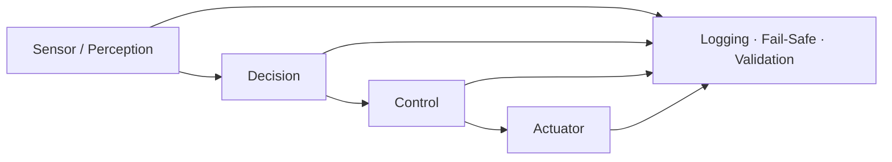

# 최용훈 | Automotive Embedded & System Software

[한국어](README.md) | [English](README.en.md)

성균관대학교 전자전기공학부에서 **차량 임베디드 SW, 자율주행 시스템 통합, 차량 네트워크와 검증 자동화**를 공부하고 있습니다.

저는 알고리즘 하나만 구현하는 것보다 센서 입력부터 판단, 제어 명령, 로그와 복구 동작까지 연결해 **전체 시스템이 실제로 동작하고 검증 가능하게 만드는 과정**에 관심이 있습니다.



## 핵심 역량

| 분야 | 경험 |
|---|---|
| 자율주행 제어 | Pure Pursuit, Stanley 계열 제어, 주차 FSM, 속도·조향 튜닝 |
| 임베디드 SW | C/C++, MCU 상태 머신, timer·PWM·ADC·UART·CAN 연동 |
| 차량 네트워크 | CAN/CAN-FD, 신호 패킹, trace parsing, timing 분석 |
| 시스템 통합 | ROS, PYNQ/DPU, MMIO, 카메라·센서·제어 흐름 연결 |
| 검증 | Fail-Safe, event logging, 데이터 QC, host-side test, 재현 가능한 분석 |

## 대표 프로젝트

### 1. 성균관대학교 자율주행 해커톤 — 최종 2위

4인 팀으로 ROS 기반 자율주행 시뮬레이션 시스템을 개발했습니다. 주차 FSM, Pure Pursuit 경로 추종, 곡률 기반 속도 제어와 RViz 디버그 도구를 통합했습니다.

- 역할: 주행·주차 제어 통합, Fail-Safe, 속도·조향 튜닝
- 해결: 주차 동작을 상태 머신으로 구조화하고 고속 구간과 급조향 구간의 속도 전략 분리
- 결과: 주차 미션 3개 중 2개 완료, 최종 2위
- [소스와 기여 근거 보기](https://github.com/choiYhunn/skku-autonomous-driving-hackathon-2025)

### 2. 자율주행 AI Chip 설계대회 — 진행 중

PYNQ의 DPU 추론 결과를 PWM 차량 제어와 연결하고 주행·주차 모드, ADC 조향 피드백과 차선 미검출 Fail-Safe를 통합하고 있습니다.

- 역할: 조향·주행 제어 통합, `max_jump`·미검출 복귀 튜닝, 실차 디버깅
- 공개 범위: 팀 source·모델·FPGA 산출물은 비공개, 검증된 시스템 설명만 공개
- [한·영 포트폴리오 보기](https://github.com/junmyounggyu/2026-autonomous-driving-hackathon-portfolio/tree/main/%EA%B5%90%EB%82%B4_%EC%9E%90%EC%9C%A8%EC%A3%BC%ED%96%89_AI_Chip_%EC%84%A4%EA%B3%84%EB%8C%80%ED%9A%8C_%EC%A7%84%ED%96%89%EC%A4%91%28%EC%B5%9C%EC%9A%A9%ED%9B%88%29)

### 3. CAN-FD 신호 패킹·수신 타이밍 연구

RA6M5 TX/RX와 PCAN trace를 이용해 A/B/C 패킹 전략의 RX inter-arrival jitter와 reconstructed occupancy를 비교한 공동 연구입니다.

- 역할: 분석 과정 구성, 데이터 QC, 조건 오류 발견, 재측정과 결과 해석
- 검증 원칙: 측정값과 추정값을 분리하고 통과하지 못한 claim gate도 보존
- 공개 범위: 연구 방법과 한계만 공개, 원본 trace·firmware·수치 결과는 승인 전 비공개
- [한·영 포트폴리오 보기](https://github.com/junmyounggyu/2026-autonomous-driving-hackathon-portfolio/tree/main/CAN-FD_%EC%8B%A0%ED%98%B8%ED%8C%A8%ED%82%B9_%EC%8B%A4%EC%8B%9C%EA%B0%84%EC%84%B1_%EC%97%B0%EA%B5%AC%28%EC%B5%9C%EC%9A%A9%ED%9B%88%29)

### 4. RA6M3 마이크로프로세서 실습

EK-RA6M3 수업 프로젝트의 애플리케이션 로직을 portable C11로 분리했습니다. 엘리베이터 제어기와 교육용 TCU 상태 머신을 PC에서 컴파일하고 assertion test로 검증할 수 있습니다.

- 역할: 상태 기반 제어 로직, peripheral 연동, 공개 가능한 core 추출과 host test
- 공개 범위: FSP 생성 코드·수업 skeleton·개인정보를 제외한 직접 구현 로직
- [소스와 테스트 보기](https://github.com/choiYhunn/ra6m3-microprocessor-lab)

## 기술 스택

```text
Languages     C · C++ · Python
Embedded      Renesas RA6M3/RA6M5 · PYNQ · PWM · ADC · UART · CAN/CAN-FD
Autonomy      ROS · Pure Pursuit · Stanley · FSM · RViz
Validation    Git · Linux · CSV/TRC analysis · event logging · host-side testing
```

## 작업 원칙

- 팀 결과와 개인 기여를 구분합니다.
- 확인되지 않은 성능과 수상, 역할을 만들지 않습니다.
- 실패 조건과 측정 한계를 결과와 함께 기록합니다.
- 개인정보, 팀원 코드, 모델·dataset과 장비 식별정보는 공개하지 않습니다.

> 공개 저장소에는 검토 가능한 source와 설명만 포함합니다. 비공개 팀 프로젝트는 공개 승인을 받은 범위만 포트폴리오로 설명합니다.
