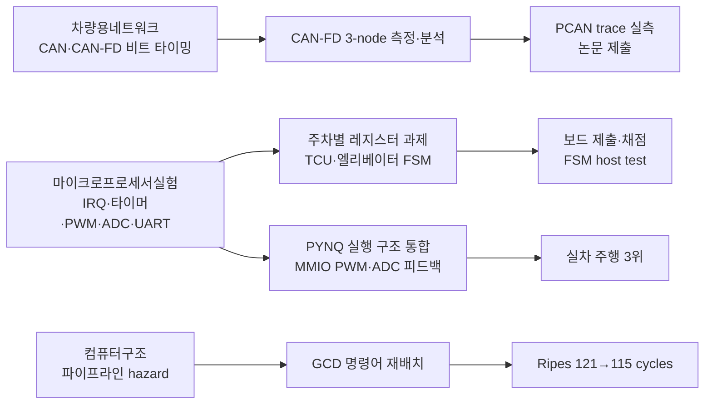

# 최용훈 | Yong Hoon Choi

성균관대학교 전자전기공학부 · [English](README.en.md)

서버 메모리 검증과 임베디드 소프트웨어를 다루고 있습니다. MCU·CAN-FD 계측과 자율주행 시스템을 경험했고, 현재는 삼성전자 DS 메모리사업부 DRAM Solution팀에서 장기현장실습 중입니다(2026.08–).

주요 관심 분야는 **메모리 시스템의 오류 관측과 신뢰성 검증**입니다. 프로그램이 요청한 동작과 실제 하드웨어가 수행한 동작, 시스템에 남은 오류 기록을 구분해서 분석하는 데 관심이 있습니다.

## 주요 기술 분야

- **메모리 시스템 검증** — 서버 DDR5 RDIMM 플랫폼 시험, Linux machine-check 오류 관측 (현장실습)
- **임베디드 펌웨어** — Renesas RA6M3에서 인터럽트·타이머·PWM·ADC·UART를 레지스터 수준으로 설정, 상태 머신과 host test
- **차량 네트워크와 계측** — CAN-FD 3-node 시험대에서 PCAN trace로 지터 측정, 교란변수 검증
- **컴퓨터구조** — RISC-V 5-stage 파이프라인의 hazard와 명령어 재배치

## 삼성전자 DS | DRAM Solution 장기현장실습

서버 DDR5 RDIMM을 대상으로 플랫폼 구성별 테스트와 메모리 오류 분석을 경험하고 있습니다.

- **실물 플랫폼 검증:** 서버 보드·CPU·DIMM 실장 구성과 슬롯/채널 배치, 부팅 및 Training 상태를 확인하며 테스트 결과를 비교했습니다.
- **C/Linux 구현:** Linux Machine Check 이벤트를 받아 기존 컨트롤러 오류 디코더로 연결하는 프로토타입을 구현했습니다. 이벤트 방식과 주기적 조회 방식의 관측 차이를 조사하고, Reader 동작과 기록 해석 문제를 디버깅했습니다. 현재 검증 중이며 정식 배포된 도구는 아닙니다.
- **컨트롤러·레지스터 분석:** CPU/컨트롤러 자료와 기존 소스를 대조해 오류 레지스터의 유효성·상세 필드, CPU 계열별 디코딩 경로와 논리적 DIMM 주소 매핑을 살펴봤습니다. BIOS/MRC의 DDR5 CA·DQ/DQS Training과 Timing/Voltage Margin도 공부하고 있습니다.

실습에서 다룬 회사 코드·로그·레지스터 덤프·장비 식별정보는 공개하지 않습니다. 위 내용은 공개 가능한 시스템·개념 수준의 설명입니다.

## 연구 및 프로젝트

| 프로젝트 | 구현·분석 내용 |
|---|---|
| **[CAN-FD 신호 패킹과 수신 타이밍](https://github.com/choiYhunn/canfd-signal-packing-timing-evaluation)** · 학부연구 | Renesas RA6M5 3-node 구성과 PCAN 로그로 5 ms 주기 프레임의 도착 간격 지터를 분석했습니다. Python 파싱·품질 검사·통계 분석을 담당했고, 초기 패킹 전략 간 차이에 배경 트래픽 생성 간격이라는 교란변수가 있음을 확인했습니다. 같은 전략에서 gap 238→240 μs 변경 시 지터 26.37→56.84 μs(n=3). [최종 재실험과 수치 검증](https://github.com/choiYhunn/canfd-signal-packing-timing-evaluation/tree/main/final_campaign) |
| **[RA6M3 마이크로프로세서 실습](https://github.com/choiYhunn/ra6m3-microprocessor-lab)** | C/FSP 기반 엘리베이터 FSM·변속 제어 로직을 구현했습니다. 개인 작성 로직을 portable C11로 분리하고 PC assertion test를 추가했습니다. 주차별 과제(인터럽트·타이머·PWM·ADC·UART)는 [수업 skeleton 대비 본인 변경분](https://github.com/choiYhunn/ra6m3-microprocessor-lab/tree/main/weekly_labs)으로 공개했습니다. 보드 주변장치 타이밍과 PC 테스트 범위는 구분했습니다. |
| **[RISC-V Pipeline Hazard](https://github.com/choiYhunn/riscv-pipeline-hazard-study)** | Forwarding이 없는 5-stage Ripes 환경에서 GCD 명령어 재배치로 **121→115 cycles**(61 instructions 유지). 원래 제출 당시 실행 화면을 저장소에 첨부했습니다. |
| **[AI-Chip 자율주행 차량](https://github.com/choiYhunn/skku-ai-chip-autonomous-driving-2026)** | PYNQ/Zynq의 카메라–DPU 추론–MMIO 모터 제어 흐름을 통합하고 실차 보정·반복 시험을 수행했습니다. AI칩 부문 동상(팀). |
| **[AMET 주황선 검출 모델 실험](https://github.com/choiYhunn/amet-2026-orange-lane-detector)** | 트랙 이미지 라벨링부터 YOLO26n 학습·ONNX 배포·실차 지연 측정까지 진행했습니다. 차량 CPU에서 추론 p50 **318.5–376.4 ms**로 측정되어 최종 레이스에는 채택하지 않았습니다. 팀은 별도 주행 스택으로 우수상(현대모비스상)을 받았습니다. |
| **[SKKU 자율주행 해커톤 2025](https://github.com/choiYhunn/skku-autonomous-driving-hackathon-2025)** | ROS Noetic에서 주차 FSM, Pure Pursuit, 곡률 기반 속도 제어를 통합했습니다. 팀 2위. |

그 밖에 [국민대 자율주행 경진대회 예선](https://github.com/choiYhunn/kookmin-autonomous-driving-competition-2026)과 [Shared Brain Starter](https://github.com/choiYhunn/shared-brain-starter) 프로젝트를 공개했습니다.

## 교육·실습

전공 과목과 외부 실습에서 배운 것이 어떤 구현과 검증으로 이어졌는지 정리했습니다. 수강·참여만 한 교육은 구현으로 적지 않습니다.

| 교육 | 상태 | 남은 본인 산출물 |
|---|---|---|
| Zonal E/E Architecture 워크숍 (HPC·4 Zone·CAN↔Ethernet·FreeRTOS) | 참여, 2026.07 | 실행 절차와 디버그 변경 1줄. 구조는 [원본 소스로 정리](TRAINING.md#zonal-ee-architecture-워크숍) |
| 차량용 이더넷 · AUTOSAR(EB tresos) · 차량용 임베디드 시스템 · ROS 2 단기강좌 | 참여 | 없음 (배포 자료만 남음) |
| H-Mobility Class 자율주행 통신·네트워크 / 카인사이드아웃 | 기본교육 수료 | 과제 서술 |
| 차량용네트워크 · 스마트카공학개론 | 수강 | Ringing·SIC 분석 보고서, AI 인지·실시간 제어 논문 과제 (문헌 분석) |

과목별 상세와 공개하지 않는 자료는 [교육·실습 기록](TRAINING.md)에 있습니다.

## 논문·수상·수료

- CAN-FD 수신 지터 연구, **2026 한국자동차공학회 추계학술대회 8쪽 Full Paper 제출**(2저자, 심사 결과 미반영)
- 2026 AMET 자율주행 해커톤 우수상(현대모비스상) · 본선 3위 — 팀
- 제4회 성균관대학교 AI 자율주행 경진대회 AI칩 부문 동상 — 팀
- 2025 성균관대학교 자율주행 해커톤 2위 — 팀
- H-Mobility Class 기본교육 수료 — 자율주행 통신 및 네트워크(18시간), 카인사이드아웃 D(14시간), 2026

## 기술

C · Python · RISC-V Assembly · Linux · Git · Renesas RA6M3/RA6M5 (e² studio/FSP) · Zynq/PYNQ · ROS/ROS 2 · CAN/CAN-FD · PCAN-USB FD · 오실로스코프 · MMIO · UART/ADC/PWM

측정 결과를 소개할 때는 실물 하드웨어·시뮬레이션·모델 계산을 구분합니다. 팀 산출물과 제공 코드는 개인 구현으로 표기하지 않습니다.
