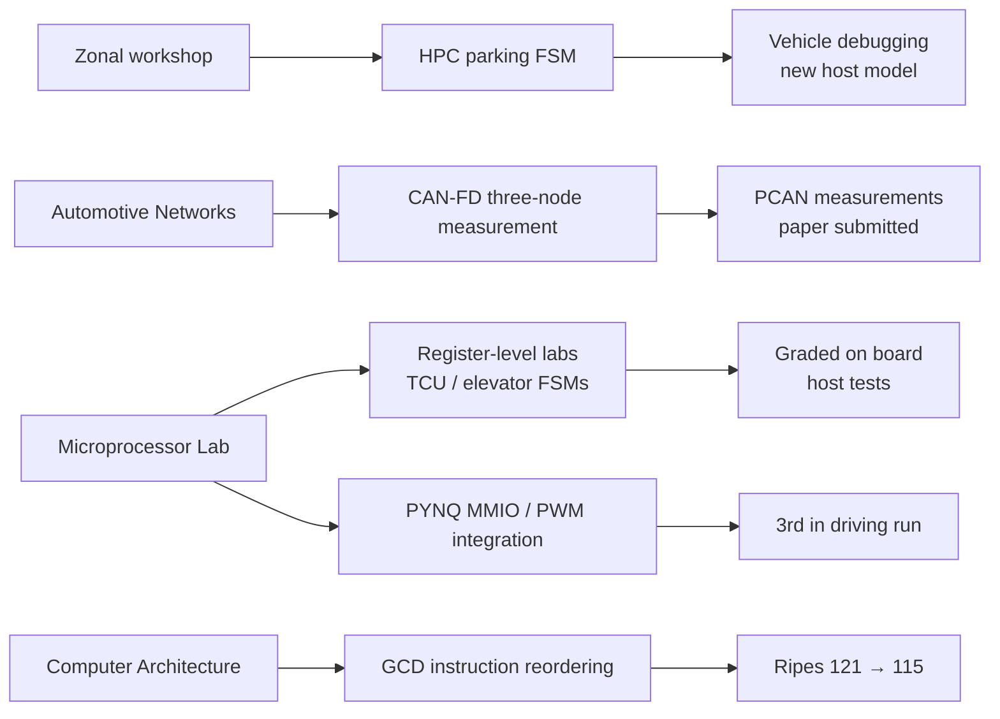
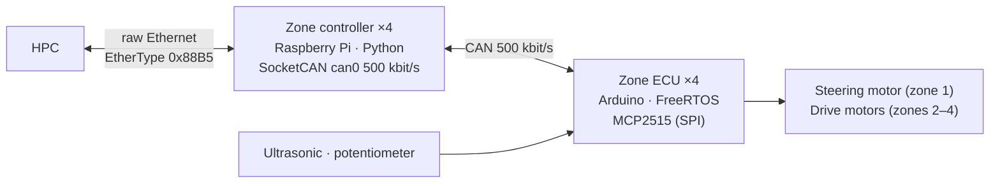

# Training and coursework

[Profile](README.en.md) · [한국어](TRAINING.md)

University courses and external hands-on training, organized by **what I learned, what I actually built, and how far it was verified**. Attending a course and implementing something are kept separate.

| Label | Meaning |
|---|---|
| Completed | A completion certificate exists (not published; it contains personal data) |
| Attended | Participation is supported by distributed material and lab setups, but there is no certificate |
| My artifact | Code or a report I wrote, confirmed against the original files |

## How the learning carried forward

The Zonal branch is backed by recovered HPC edits and field logs. Other short courses remain training records where independently publishable personal implementations have not been found. See the [artifact review](docs/technical-notes/artifact-review.en.md).

## Zonal E/E Architecture workshop

SKKU Automation Lab · Future-Vehicle Bootcamp short course · 6–8 July 2026 (three days) · **Attended**

A small Zonal testbed in which one HPC and four zones are connected over CAN and Ethernet; the labs built up the flow of sensor, steering and drive commands between ECU → zone controller → HPC step by step. The structure below was confirmed from the workshop's final source (`project/`). That source is workshop-provided and is not redistributed.

**CAN IDs per zone**

| Zone | Role | Command | Sensor | Heartbeat | Other |
|---|---|---:|---:|---:|---|
| 1 | Front / steering | `0x11` | `0x13` | `0x14` | Steering feedback `0x12` |
| 2 | Right / drive | `0x21` | `0x23` | `0x24` | |
| 3 | Left / drive | `0x31` | `0x33` | `0x34` | |
| 4 | Rear / drive | `0x41` | `0x43` | `0x44` | |

**Zone controller ↔ HPC frame**: EtherType `0x88B5`, payload `!4sBBBBHB8s` = magic `ZCAN` · version 1 · message type · source zone · destination zone · CAN ID · DLC · 8 data bytes. The zone controller runs three threads:
- a one-second keepalive;
- CAN → HPC, forwarding only this zone's sensor, heartbeat and feedback IDs;
- HPC → CAN, sending a frame to CAN only if it comes from the HPC (zone 0) and its destination, message type and command ID match.

**ECU (FreeRTOS)**: a control task (priority 4), a sensor task (3, 100 ms) and a heartbeat task (5, 50 ms) share CAN access through a mutex. Heartbeat status bits: alive `0x01`, sensor fault `0x02`, actuator fault `0x04`, CAN error `0x08`. Zone 1 limits the steering command to 12° and steers by time (65 ms per degree, no encoder).

**Lab progression**: one-ECU bridge (motor stops after one second without commands) → three zones → four zones plus camera streaming → camera only → final four-zone CAN/Ethernet bridge.

**My HPC application work, recovered from the July 8 session**

- Specified the sequence: right-side detection → forward 1 s → full-left forward 2.5 s → full-right reverse 3 s → reverse until Zone 4 distance <20 cm.
- Deployed and ran Python on the HPC; revised detection/state logic and diagnostic logging with AI assistance. Directed steering-sign inversion after observing the vehicle and compared Zone 2/3 firmware when Zone 3 moved forward under a reverse request.
- Recovered the local incomplete `parking.py` outside the workshop tree, plus versions 2–8 by replaying historical file creation and successful edits. These reconstructed historical files are not redistributed.

The earlier “one-line debug change only” description applied to the inspected ECU distribution tree and missed the HPC application. It did not describe my full role. The independent [controller project](https://github.com/choiYhunn/zonal-autoparking-controller) now separates [architecture](https://github.com/choiYhunn/zonal-autoparking-controller/blob/main/docs/architecture.md), [FSM](https://github.com/choiYhunn/zonal-autoparking-controller/blob/main/docs/parking-state-machine.md), [debugging](https://github.com/choiYhunn/zonal-autoparking-controller/blob/main/docs/debugging.md) and [provenance](https://github.com/choiYhunn/zonal-autoparking-controller/blob/main/docs/provenance.md).

**Hardware result:** logs contain four-zone sensor reception, entry into the earlier FSM's reverse-to-wall state and timeout with a stop request. User observations document reversed steering and Zone 3 motion mismatch. The final v8 inversion edit is recoverable, but final parking success and post-fix wheel behavior remain unverified. Socket-send success is not actuator acknowledgement.

**Public implementation:** a new portable Python FSM and 26 host tests. The supplied ZCU/ECU baseline and historical skeleton remain private; new sensor-freshness/scan-timeout guards are host-model additions. Final ECU command-loss stopping, network latency and parking accuracy were not measured.

## External hands-on training

| Course | Period · status | Topics | Hardware / tools | My surviving artifacts |
|---|---|---|---|---|
| Automotive Ethernet (Future-Vehicle Bootcamp) | 30 Jun – 2 Jul 2026 · attended | In-vehicle Ethernet, Ethernet–CAN conversion, VLAN security, TSN (PTP, TAS), Wireshark analysis | Renesas RA6M3 evaluation board, Kvaser | None — the only capture left is a distributed example |
| Embedded SW Platform (AUTOSAR) | Dec 2025 · attended | Classic AUTOSAR layers (SWC, RTE, BSW, MCAL), ECU configuration in EB tresos | EB tresos | None — no configuration output survives. This does not mean I implemented an AUTOSAR ECU |
| Automotive Embedded Systems | 26 Jan – 7 Feb 2026 · attended | Register/HAL, interrupts, FND, DC motor | Renesas RA6M3, e² studio/FSP | None — the local lab source is identical to the distributed copy. My own RA6M3 code is in the [Microprocessor Lab](https://github.com/choiYhunn/ra6m3-microprocessor-lab) |
| Mobility ROS 2 Fundamentals | 5–6 Feb 2026 · attended | ROS 2 nodes and topics, camera/sensor packages, introductory YOLO | ROS 2 | None |
| H-Mobility Class (Hyundai NGV, online) | 20 Apr – 26 Jun 2026 · **completed** | Autonomous driving — communication and networks, 18 h: CAN/CAN-FD/CAN-XL, LIN, Automotive Ethernet and TSN, gateway and AUTOSAR communication, UDS/XCP, V2X, UWB · Car Inside Out D, 14 h: vehicle structure | — | Both basic tracks completed (not the advanced programme); private study notes remain. Located assignment text files contain prompts only; submitted answers were not recovered |

## University courses

| Course | What I did | Kind of evidence |
|---|---|---|
| Microprocessor Lab (RA6M3) | Weekly assignments at register level ([diffs against the skeleton](https://github.com/choiYhunn/ra6m3-microprocessor-lab/tree/main/weekly_labs)); TCU and elevator FSMs | Graded on the board; host tests for the FSMs |
| Computer Architecture | GCD-loop hazard analysis and reordering on a five-stage pipeline without forwarding ([repository](https://github.com/choiYhunn/riscv-pipeline-hazard-study)) | Ripes simulation, 121 → 115 cycles |
| Automotive Networks (graduate-numbered) | Report "What is Ringing? — in the context of CAN-FD": impedance discontinuities and reflections, stubs, termination, sample point, TDC/SSP, SIC transceivers | Literature analysis; [revised note / PDF](docs/technical-notes/can-fd-ringing-sic.en.md), with technical corrections and identifiers removed |
| Smart Car Engineering | Paper assignment "Trends in AI Perception and Real-Time Control Architectures for Autonomous Driving": sensor fusion, AI accelerators and memory bottlenecks, in-vehicle networks | Literature analysis; [rewritten note / PDF](docs/technical-notes/perception-memory-control.en.md), with new diagrams and no third-party figures |
| Control Engineering, Electronic Circuits I, Signals and Systems | Coursework | No personal artifact to publish |

**In progress**: Semiconductor Device, Circuit Design and Systems convergence track (micro-degree), planned through 2027-2; not completed.

## Not published

Lecture slides, videos and transcripts; lab code and answers distributed by the workshops and courses; past exams; other students' work; commercial tools and installers; certificates, transcripts and other files with personal data.
