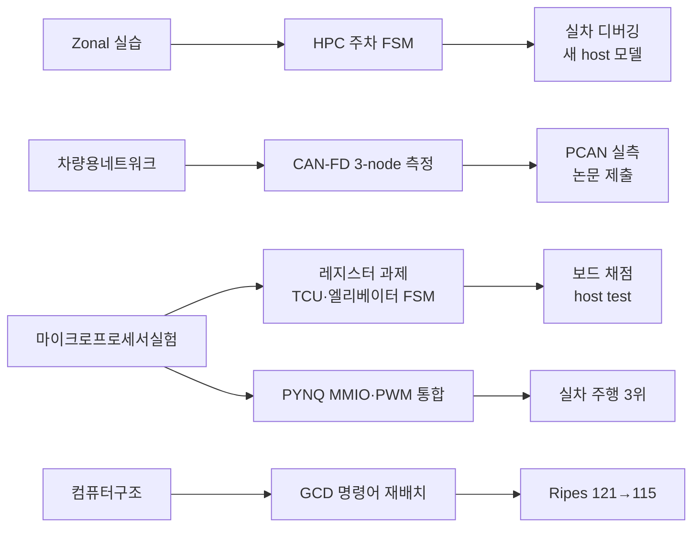
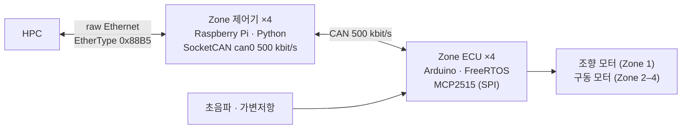

# 교육·실습 기록

[프로필](README.md) · [English](TRAINING.en.md)

이수한 전공 과목과 외부 실습 교육을 **무엇을 배웠고, 실제로 무엇을 만들었고, 어디까지 확인됐는지** 기준으로 정리했습니다. 수강했다는 사실과 직접 구현했다는 사실은 구분합니다.

| 표시 | 뜻 |
|---|---|
| 수료 확인 | 수료증이 있음 (개인정보가 있어 파일은 공개하지 않음) |
| 참여 | 배포 자료·실습 환경으로 참여는 확인되지만 수료증은 없음 |
| 본인 산출물 | 제가 작성했음을 원본으로 확인한 코드·보고서 |

## 배운 것이 어디로 이어졌나

Zonal은 복원한 HPC 코드 수정 기록과 현장 로그를 근거로 구현 경로에 연결했습니다. 다른 단기강좌는 독립 공개할 개인 구현이 확인되지 않은 교육 이력으로 구분합니다. [산출물 재검토](docs/technical-notes/artifact-review.md)에 공개·보류 판단을 기록했습니다.

## Zonal E/E Architecture 워크숍

성균관대학교 자동화연구실 · 미래차 부트캠프 단기강좌 · 2026-07-06 ~ 07-08 (3일) · **참여**

HPC 한 대와 4개 Zone이 CAN과 Ethernet으로 연결된 소형 Zonal 테스트베드에서, 센서·조향·구동 명령이 ECU → Zone 제어기 → HPC로 오가는 흐름을 단계별로 구성했습니다. 아래 구조는 워크숍이 배포한 최종 소스(`project/`)에서 확인한 내용입니다. 소스 자체는 워크숍 제공 코드라 재배포하지 않습니다.

**Zone별 CAN ID**

| Zone | 역할 | 명령 | 센서 | Heartbeat | 기타 |
|---|---|---:|---:|---:|---|
| 1 | 전방·조향 | `0x11` | `0x13` | `0x14` | 조향 피드백 `0x12` |
| 2 | 우측·구동 | `0x21` | `0x23` | `0x24` | |
| 3 | 좌측·구동 | `0x31` | `0x33` | `0x34` | |
| 4 | 후방·구동 | `0x41` | `0x43` | `0x44` | |

**Zone 제어기 ↔ HPC 프레임**: EtherType `0x88B5`, payload `!4sBBBBHB8s` = magic `ZCAN` · version 1 · 메시지 종류 · 출발 Zone · 도착 Zone · CAN ID · DLC · 데이터 8바이트. Zone 제어기는 세 스레드로 동작합니다.
- 1초 주기 keepalive
- CAN → HPC: 자기 Zone의 센서·heartbeat·피드백 ID만 전달
- HPC → CAN: 출발 Zone이 HPC(0)이고, 도착 Zone·메시지 종류·명령 ID가 맞는 프레임만 CAN으로 송신

**ECU (FreeRTOS)**: 제어 태스크(우선순위 4), 센서 태스크(3, 100 ms), heartbeat 태스크(5, 50 ms)가 mutex로 CAN 접근을 나눕니다. Heartbeat 상태 비트는 alive `0x01`, 센서 이상 `0x02`, 구동기 이상 `0x04`, CAN 오류 `0x08`입니다. Zone 1은 조향 명령의 크기를 12°로 제한하고, 엔코더 없이 1°당 65 ms 구동하는 시간 기반 방식으로 조향합니다.

**실습 단계**: ECU 1개 브리지(명령이 1초 끊기면 모터 정지) → 3 Zone → 4 Zone + 카메라 스트리밍 → 카메라 전용 → 최종 4 Zone CAN/Ethernet 브리지.

**7월 8일 기록에서 복원한 본인 HPC 작업**

- 우측 차량 감지 → 1초 직진 → 좌측 풀조향 2.5초 전진 → 우측 풀조향 3초 후진 → Zone 4 거리 <20 cm까지 후진하는 순서를 지정했습니다.
- HPC에 Python을 배포·실행하고 AI 보조로 감지 조건·상태 전환·진단 로그를 수정했습니다. 실제 차량에서 조향 반전을 관찰해 부호 변경을 요청했고, 후진 명령에서 Zone 3만 전진하는 현상을 보고 Zone 2/3 펌웨어 비교와 개별 방향 보정을 진행했습니다.
- 워크숍 폴더 밖에서 미완성 원본 `parking.py`를 찾았습니다. 이후 버전 2–8은 과거 생성 코드와 성공한 수정 기록을 재적용해 복원했습니다. 이 역사적 재구성본은 원본 파일과 구분하고 재배포하지 않습니다.

기존의 “디버그 변경 1줄뿐”이라는 설명은 배포 ECU 폴더만 비교한 결과였습니다. HPC 애플리케이션을 조사에서 빠뜨려 본인 역할을 축소한 부분을 정정했습니다. 독립 [주차 제어 프로젝트](https://github.com/choiYhunn/zonal-autoparking-controller)에서 [구조](https://github.com/choiYhunn/zonal-autoparking-controller/blob/main/docs/architecture.md), [상태 머신](https://github.com/choiYhunn/zonal-autoparking-controller/blob/main/docs/parking-state-machine.md), [디버깅](https://github.com/choiYhunn/zonal-autoparking-controller/blob/main/docs/debugging.md), [출처·기여](https://github.com/choiYhunn/zonal-autoparking-controller/blob/main/docs/provenance.md)를 확인할 수 있습니다.

**실물에서 확인한 범위:** 네 Zone 센서 수신, 이전 FSM의 후방 접근 상태 진입과 timeout·정지 명령 출력이 남아 있습니다. 조향 반전과 Zone 3 방향 불일치는 당시 관찰·수정 기록이 있습니다. v8 보정 후 바퀴 동작과 최종 주차 성공은 미확인입니다. socket 송신 성공은 구동기 응답 확인과 다릅니다.

**공개 구현:** 새로 분리한 portable Python FSM과 26개 host test를 공개했습니다. 제공된 ZCU/ECU·HPC skeleton은 포함하지 않았습니다. 센서 freshness·탐색 timeout은 현재 모델에 추가한 기능이며 당시 실물 검증으로 표시하지 않습니다. 최종 ECU의 링크 단절 시 정지, 지연·정확도 수치는 확인되지 않았습니다.

## 외부 실습 교육

| 교육 | 기간 · 상태 | 다룬 내용 | 하드웨어·도구 | 남은 본인 산출물 |
|---|---|---|---|---|
| 차량용 이더넷 (미래차 부트캠프) | 2026-06-30 ~ 07-02 · 참여 | 차량 내부 Ethernet, Ethernet–CAN 변환, VLAN 보안, TSN(PTP·TAS), Wireshark 분석 | Renesas RA6M3 평가보드, Kvaser | 없음 — 남은 캡처는 배포 예제뿐 |
| 차량용 임베디드 SW 플랫폼 (AUTOSAR) | 2025-12 · 참여 | Classic AUTOSAR 계층(SWC·RTE·BSW·MCAL), EB tresos 기반 ECU 구성 | EB tresos | 없음 — 설정 산출물이 남아 있지 않음. AUTOSAR ECU를 구현했다는 뜻이 아닙니다 |
| 차량용 임베디드 시스템 | 2026-01-26 ~ 02-07 · 참여 | Register/HAL, 인터럽트, FND, DC 모터 | Renesas RA6M3, e² studio/FSP | 없음 — 로컬 실습 소스가 배포본과 같음. 직접 작성한 RA6M3 코드는 [마이크로프로세서실험](https://github.com/choiYhunn/ra6m3-microprocessor-lab)에 있음 |
| 모빌리티 ROS2 핵심입문 | 2026-02-05 ~ 06 · 참여 | ROS 2 노드·토픽, 카메라·센서 패키지, YOLO 입문 | ROS 2 | 없음 |
| H-Mobility Class (현대자동차 NGV, 온라인) | 2026-04-20 ~ 06-26 · **수료 확인** | 자율주행 통신 및 네트워크 18시간: CAN/CAN-FD/CAN-XL, LIN, Automotive Ethernet·TSN, 게이트웨이·AUTOSAR 통신, UDS·XCP, V2X, UWB · 카인사이드아웃 D 14시간: 자동차 구조 | — | 두 기본교육 수료(심화과정 아님). 개인 학습노트 보존. 과제 txt는 문항만 확인; 제출 답안 미복구 |

## 전공 과목

| 과목 | 직접 한 것 | 근거의 종류 |
|---|---|---|
| 마이크로프로세서실험 (RA6M3) | 주차별 과제를 레지스터 수준으로 구현([skeleton 대비 변경분](https://github.com/choiYhunn/ra6m3-microprocessor-lab/tree/main/weekly_labs)), TCU·엘리베이터 FSM | 보드 제출·채점, FSM은 host test |
| 컴퓨터구조론 | forwarding 없는 5-stage에서 GCD 루프 hazard 분석·재배치 ([저장소](https://github.com/choiYhunn/riscv-pipeline-hazard-study)) | Ripes 시뮬레이션 121→115 cycles |
| 차량용네트워크 (대학원 번호 과목) | 보고서 「What is Ringing? — CAN-FD 관련」: 임피던스 불연속과 반사, 스텁·종단·샘플 포인트·TDC/SSP, SIC 트랜시버 | 문헌 분석. [공개 개정 기술 노트·PDF](docs/technical-notes/can-fd-ringing-sic.md); 개인정보 제거와 기술 설명 정정. 실측·시뮬레이션 아님 |
| 스마트카공학개론 | 논문 과제 「자율주행 시스템에서 AI 인지와 실시간 제어 구조의 발전 동향」: 센서 퓨전, AI 반도체와 메모리 병목, 차량 내부 네트워크 | 문헌 분석. [공개 재작성 노트·PDF](docs/technical-notes/perception-memory-control.md); 외부 그림 대신 새 도식 사용 |
| 제어공학, 전자회로1, 신호및시스템 | 수강 | 공개할 본인 산출물 없음 |

**진행 중**: 반도체소자회로설계및시스템 융합트랙(마이크로디그리) — 2027-2까지 이수 예정이며 아직 수료가 아닙니다.

## 공개하지 않는 것

강의 교안·영상·대본, 워크숍과 수업이 배포한 실습 코드와 정답, 기출 자료, 다른 학생의 자료, 상용 도구와 설치 파일, 수료증·성적표 등 개인정보가 담긴 파일.
