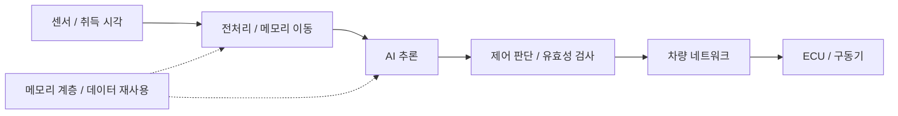

# AI 인지의 메모리 병목과 차량 제어 경로

공개용 재작성 기술 노트 · 스마트카공학개론 개인 논문형 과제 기반 · [English](perception-memory-control.en.md) · [PDF](perception-memory-control.pdf)

원래 과제에서는 센서 퓨전, AI 가속기의 메모리 이동, Zonal 구조와 실시간 제어를 함께 분석했습니다. 제출 PDF에는 외부 그림과 학교 이메일이 포함되어 있어 그대로 공개하지 않았습니다. 이 공개본은 본인의 분석 관점을 다시 쓰고 도식을 새로 그렸습니다. 문헌 검토이며 새로운 논문 발표·실험·하드웨어 구현 결과는 아닙니다.

## 연산량만으로 전체 지연을 설명할 수 없는 이유

센서에서 제어 출력까지의 경로에는 취득, 전처리, 데이터 이동, 추론, 통신과 구동 단계가 있습니다. 가속기의 연산 처리량이 높아도 입력과 중간 결과를 메모리에서 옮기는 비용이 크면 전체 경로가 지연될 수 있습니다. Eyeriss 연구는 데이터 재사용과 메모리 계층을 고려해 데이터 이동 에너지를 줄이는 구조를 다룹니다. 이를 내 시스템의 가속 비율이나 DRAM 측정 결과로 해석하지 않습니다. [Eyeriss, ISCA 2016](https://dspace.mit.edu/entities/publication/f6342515-2b7d-411c-a8ad-a9edb23dd394)

## 구조를 나누어 본 분석

| 경로 | 설계·분석 질문 | 필요한 검증 |
|---|---|---|
| 센서 취득·융합 | 입력들의 취득 시점과 유효 시간이 맞는가? | 센서 타임스탬프·지연 분포와 실패 사례 |
| 추론·메모리 | 연산, 데이터 이동, 메모리 용량 중 어느 조건이 병목인가? | 대상 장치의 프로파일과 사용량; 다른 시스템 수치 전용 금지 |
| HPC–Zone–ECU | 위치 기반 연결과 기능 제어의 책임을 어디에 둘 것인가? | 실제 메시지 경로, 필터, 명령·센서 연결 확인 |
| 네트워크 | 동기화·큐잉·스케줄링 조건을 어떻게 설정하는가? | 구성과 부하 조건을 명시한 측정 |
| 안전 감독 | 판단 지연·무효 입력·링크 단절 시 어떤 상태로 가는가? | 독립적인 감독과 fault-injection 시험 |

자율주행 딥러닝 기법을 정리한 문헌은 인지부터 제어까지 서로 다른 접근을 비교합니다. 이 비교를 바탕으로, 인식 정확도와 제어 경로의 시간·오류 조건을 함께 질문해야 한다고 정리했습니다. 특정 센서 조합이나 E2E 방식의 우열을 내 실험으로 입증한 것은 아닙니다. [Grigorescu et al., 2020](https://arxiv.org/abs/1910.07738)

TSN 역시 명칭만 도입한다고 전체 차량의 deadline이 보장되는 것은 아닙니다. IEEE 802.1DG는 자동차 Ethernet을 위한 TSN profile을 다룹니다. 이 문헌의 범위와 교육에서 다룬 개념, 본인이 실제로 구성한 시스템을 구분해야 합니다. 내 Zonal 워크숍은 raw Ethernet–CAN 브리지와 주차 애플리케이션 실습이며 TSN 구현 실적이 아닙니다. [IEEE 802.1DG](https://1.ieee802.org/tsn/802-1dg/)

## 개인 프로젝트와 연결되는 질문

Zonal 주차에서는 센서 값이 있다는 사실과 그 값으로 상태를 바꿔도 되는지를 구분했습니다. CAN-FD 연구에서는 패킹 효과처럼 보인 차이를 배경 트래픽 생성 조건과 분리했습니다. RA6M3에서는 상태 전환과 실제 주변장치 동작의 검증 범위를 나눴습니다. RISC-V 과제는 hazard 조건과 시뮬레이터 설정을 고정한 비교였습니다. 이 사례들은 서로 다른 계층에서 '요청한 동작, 관측한 결과, 결과가 지지하는 주장'을 구분하는 작업으로 이어집니다.

메모리 시스템 검증에 대한 현재 관심도 이 관측 문제와 연결됩니다. 다만 이 과제 자체를 DRAM 플랫폼·CXL 검증이나 안전 인증 경험으로 적지는 않습니다. 원문에 있던 일반적인 저정밀도 성능 배수, 안전성 보장 표현과 외부 그림은 공개본에 옮기지 않았습니다.

관련 자료: [Zonal 구현](https://github.com/choiYhunn/zonal-autoparking-controller) · [CAN-FD 실측](https://github.com/choiYhunn/canfd-signal-packing-timing-evaluation) · [RA6M3](https://github.com/choiYhunn/ra6m3-microprocessor-lab) · [RISC-V](https://github.com/choiYhunn/riscv-pipeline-hazard-study)
